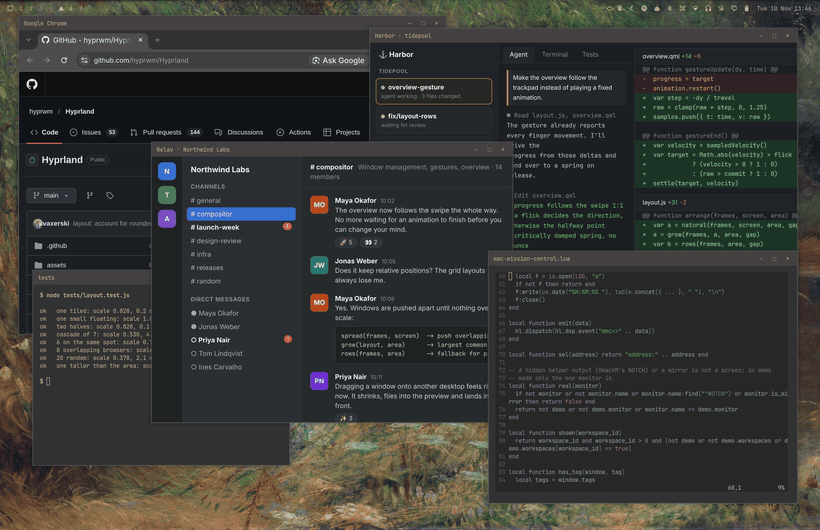
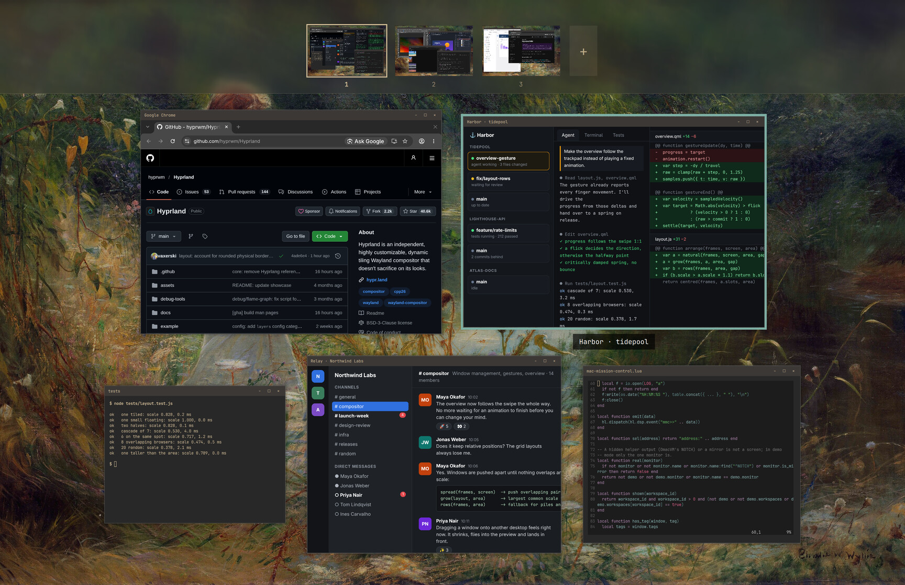
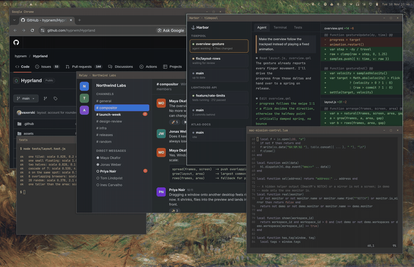

# Mac Mission Control for Omarchy

Swipe up with four fingers and every window of the desktop spreads out so that
none overlaps. The windows follow your fingers the whole way, and the
desktops run along the top as live previews.



It is a plugin for [Omarchy](https://omarchy.org)'s shell with a small Hyprland
half that the plugin loads by itself. Nothing to compile, and nothing to add to
your Hyprland config.

## What it does

- **Follows the trackpad.** The swipe drives the animation directly: stop half
  way, go back, carry on. Lift your fingers and a spring finishes the movement
  in the direction you were going.
- **Arranges windows like Mission Control.** Windows keep their place relative
  to each other and share one scale, so the big window stays the big one and
  the one in the top right corner stays there. Piles and cascades, as they
  build up on floating workspaces, are packed into rows.
- **Live copies.** What you see are the windows themselves, still updating,
  with their titlebars, borders and shadows. The start and the end of the
  swipe are seamless.
- **Desktops along the top.** Every workspace of the monitor as a live preview
  on a frosted bar. It comes down over the menu bar and starts below a camera
  notch.
- **Every monitor at once**, each with its own desktops.



### Page through the desktops

With the overview open, four fingers sideways slide to the next desktop, which
arrives spread out as well. A click on a preview opens that desktop.


### Move a window to another desktop

Drag it onto a preview. It shrinks as it nears the bar, flies into place and
ends up in front of what is there. Drop it on `+` for a new desktop. With
several monitors, the previews of the other monitors take it too.


### Reorder the desktops

Drag a preview sideways. The numbers stay where they are and their contents
move along.



## Install

```sh
omarchy plugin add https://github.com/gillesgoetsch/omarchy-mac-mission-control.git --enable
```

Then swipe up with four fingers, or press `Ctrl` + `↑`.

Needs Omarchy 4 with its Lua Hyprland config (Hyprland 0.56 or newer) and a
touchpad that reports four fingers for the gestures. The keys work without one.

Update with `omarchy plugin update mac.missioncontrol`, remove with
`omarchy plugin remove mac.missioncontrol` followed by `hyprctl reload`.

## Use

| Input | Does |
|---|---|
| 4 fingers up | open, following the fingers |
| 4 fingers down | close, the same way; with the pointer on a window, into that window |
| 4 fingers left / right, while open | the next / previous desktop |
| `Ctrl` + `↑`, Mission Control key (`F3`) | toggle |
| click a window | switch to it |
| drag a window onto a desktop | move it there (`+`: a new desktop) |
| click a desktop | open it |
| drag a desktop sideways | reorder |
| `Super` or `Ctrl` + `W`, pointer on a window | close that window |
| `Super` or `Ctrl` + `Q`, pointer on a window | quit its app (a terminal: only that window) |
| `Super` + `1`…`0` | that desktop, with the overview still open |
| `Esc`, click on the wallpaper | leave |

While the overview is open only these keys are active; your other shortcuts
are back when it closes.

## Settings

All optional. Put a table named `mac_mission_control_config` anywhere in your
Hyprland config (`~/.config/hypr/hyprland.lua` for instance) and run
`hyprctl reload`:

```lua
mac_mission_control_config = {
  fingers = 4,                           -- 3 if you prefer three-finger swipes
  keys = { "CTRL + UP", "XF86LaunchA" }, -- the keys that toggle it
  travel = 140,                          -- swipe distance from closed to open; smaller is more sensitive
  gap = 40,                              -- pixels between two windows in the overview
  preview_height = 96,                   -- height of a desktop preview in the bar
  notch = { ["eDP-1"] = 37 },            -- a camera notch: its height in logical pixels, per monitor
  sideways = true,                       -- see below
  log = false,                           -- one line per swipe in ~/.cache/mac-mission-control.log
}
```

**The Mission Control key.** On a Mac running Linux the key is `XF86LaunchA`,
which is bound by default. In a virtual machine on a Mac it can arrive as a
plain `F3` instead; add `"F3"` to `keys` then.

**Sideways paging.** A finger count and direction can have only one gesture in
Hyprland. While the overview is open the plugin borrows your workspace swipe
and gives it back afterwards. It does so when `~/.config/hypr/input.lua`
contains the swipe the way Omarchy suggests it:

```lua
hl.gesture({ fingers = 4, direction = "horizontal", action = "workspace" })
```

If your workspace swipe is set up elsewhere, set `sideways = true`; set it to
`false` to keep the plugin away from it.

**Workspaces per monitor.** A monitor's desktops are the workspaces in its block
of ten (1–10, 11–20, …), which is how Omarchy numbers them, and each is shown
with its number in that block.

## How it works

Hyprland reports every finger movement of the swipe to the shell. The plugin
draws a live copy of each window exactly where the window is, and once the
copies have a picture it maps its overlay; Hyprland hides the real windows in
that same frame and shows them again when the overlay goes. In between only the
copies move, which is why the swipe can be followed frame by frame.

The layout zooms the screen out and pushes overlapping windows apart (the
"natural" layout KWin's Present Windows uses to imitate Exposé), then grows the
result to the largest scale that still fits.

[docs/DEVELOPING.md](docs/DEVELOPING.md) has the details, the pitfalls and how
to work on it.

## If something goes wrong

- **Windows stay invisible** after a crash of the shell:
  `hyprctl eval 'mac_mission_control.reset()'`, or `hyprctl reload`.
- **Nothing happens on a swipe:** `omarchy plugin list` should show
  `mac.missioncontrol` as enabled, and
  `omarchy-shell shell call mac.missioncontrol debugState ""` should answer.
- **Four fingers sideways still switch workspaces** while the overview is open:
  see *Sideways paging* above.

## About the screenshots

The windows called *Harbor* and *Relay* are stand-in pages
([docs/demo](docs/demo)) opened as app windows; the others are Chrome, the
ArtCraft apps and terminals with sample files.

## License

[MIT](LICENSE)
